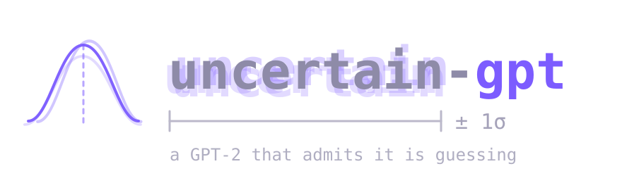

<p align="center">
  
</p>

A benchmark suite for what a Bayesian deep learning method costs to train. A
GPT-2 written from scratch in C and CUDA, where the weights are distributions
instead of numbers, and every method runs on the *same* kernels, the same data
path, the same optimizer constants and the same precision — so an arm differs
only in what it stores and how many passes it makes over that store. You cannot
share kernels you do not own, which is why this is from scratch.

- `gpt2_kernels.cuh` — the network and the harnesses. Kernels, layout, forward,
  backward, data, checkpointing, region timing (`bench_*`) and the uncertainty
  evaluation (`uq_evaluate`). Shared by every arm, so a fix lands everywhere.
- One `.cu` per method, ~150 lines each, containing *only* how the weights are
  sampled and updated: Bayes-by-Backprop, Vadam, low-rank + diagonal covariance,
  and a deep-ensemble control arm. Each is a method from published work.
- `train_bnn.c` — the deterministic CPU reference every kernel was checked
  against. `dev/` is where each kernel was built and validated one at a time.

**Adding a method** is two functions — an update kernel and a `uq_sample_fn`
callback returning posterior draw *s* — in one file:
**[`docs/adding-an-arm.md`](docs/adding-an-arm.md)**.

```
python3 -m venv .venv && .venv/bin/pip install tiktoken numpy tqdm requests
.venv/bin/python3 data/tinyshakespeare.py --model=gpt-2  # download Shakespeare
.venv/bin/python3 data/prepare_char.py                   # char-level .bin the trainers read

make train_bnn_gpu && ./train_bnn_gpu overfit   # memorize one batch (smoke test)
make train_bnn_gpu && ./train_bnn_gpu           # train
make test                                       # run every variant, print one table
```

Built for an RTX 2060 (`sm_75`); override with `make ARCH=sm_XX`.

`paper/` holds the write-up — the suite, and what it found using the suite:
`make -C paper`. Its tables are generated from `runs/`, never typed. Read it
here: [`paper/main.pdf`](paper/main.pdf) (CI-built).

## From Python

The same trainer, importable — reproduce the four-arm comparison, or run one
method on your own configuration, without writing C.

```bash
pip install -e . --no-build-isolation
```

```python
import uncertain

t = uncertain.Trainer(method="lowrank", rank=8,
                      n_layer=6, n_head=6, n_embd=384,
                      data="data/text8/text8_train.bin",
                      val_data="data/text8/text8_val.bin")

t.step()                          # one training step, on the existing CUDA kernels
mu = t.parameters()               # zero-copy torch views of the live GPU buffers
nlpd, ece, ale, epi = t.evaluate()
```

`method` is `"bbb"`, `"vadam"`, `"lowrank"` or `"ensemble"` — the same four arms,
the same four files. The package wraps the *training step*, not the tensor op:
it `#include`s the arm sources verbatim and lifts what used to be their `main()`
into a class. No kernel, optimizer or metric is reimplemented in Python.

Full API, design rationale and a verification checklist: **[`SPEC.md`](SPEC.md)**.

Four things to know before you install:

- **`nvcc` is required**, and the CUDA is compiled when you install. That is the
  deliberate trade — a fast artifact for a few serious users over a portable
  slow one for many. There is no pure-PyTorch fallback path and there will not
  be one. `--no-build-isolation` is required so the build uses the torch you
  already have. **Your `nvcc` must match torch's CUDA major version** — check
  `nvcc --version` against `python3 -c "import torch; print(torch.version.cuda)"`
  before you start, because a mismatch is what the build stops on.
- **fp32 only.** No bf16, no fp16, no autocast, no multi-GPU. The comparison was
  run in fp32 and the kernels are written for it.
- **`sm_75` is the default**, matching the `Makefile`. Override with
  `UNCERTAIN_CUDA_ARCH=8.6 pip install -e . --no-build-isolation` (or set
  `TORCH_CUDA_ARCH_LIST`). If you build for the wrong arch you will get a
  no-kernel-image error at the first step.
- **Timings on another card are that card's numbers.** Everything quoted in this
  repository — 13.33 ms/step for Vadam, 52.07 for low-rank at r=8 — was measured
  on an RTX 2060 at `sm_75`, at `C=384 L=6 V=27 B=4 T=64`. A different GPU,
  a different arch flag or a different configuration will give different
  numbers. That is not a bug and please do not file it as one.

Going through Python does not cost throughput: measured against the standalone
binaries on the same card and the same toolchain, the per-step delta ranges from
−0.45 % to +0.80 % across the four arms, straddling zero and inside each arm's
own run-to-run spread — the wrapper's cost is below what the binaries' own CUDA
event timer can resolve. The step-by-step numbers, and the caveats that come
with them, are in [`SPEC.md`](SPEC.md) §6.

The deterministic scaffolding (`train_gpt2.c`, the data pipeline) follows
Karpathy's [llm.c](https://github.com/karpathy/llm.c). MIT, same as llm.c.
